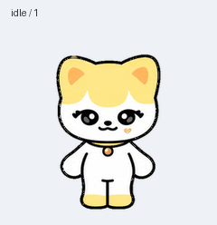

# cheez · Codex 桌面宠物

黄白色小猫 cheez，带爱心腮红和铃铛项圈。最新版待机时全程睁眼，仅保留轻微呼吸。

## 下载与导入

下载仓库中的 **[cheez-pet.zip](cheez-pet.zip)**，按 **[导入教程](IMPORT.md)** 放入自己的 Codex 宠物目录，重新打开应用后选择 **cheez**。

也可以点击仓库右上角 **Code → Download ZIP** 下载全部文件，再打开其中的 `cheez-pet.zip`，解压出真正用于安装的 `cheez/` 文件夹。

## 成品内容

- 9 组动作：待机、左右跑动、挥手、跳跃、沮丧、等待、思考、检查。
- 16 个视线方向。
- v2 透明 PNG 精灵图：1536 × 2288，单格 192 × 208。
- 待机不眨眼。

## 文件

| 文件 | 用途 |
| --- | --- |
| `cheez-pet.zip` | 可直接解压安装的成品包 |
| `pet.json` | 宠物名称、描述和 v2 格式声明，与成品包内一致 |
| `spritesheet.png` | 完整透明动画精灵图，与成品包内一致 |
| `IMPORT.md` | 中文导入教程 |
| `idle.gif` / `all-states.gif` | 动画预览 |

这是一个宠物素材包。图像由内置图像生成工具结合参考图制作，已校验帧数、透明背景和精灵图布局。

导入目录依据本机现有自定义宠物配置整理；官方的宠物选择、显示和刷新说明见 [OpenAI Pets 文档](https://learn.chatgpt.com/docs/pets)。不同应用版本的菜单名称可能略有差异。
